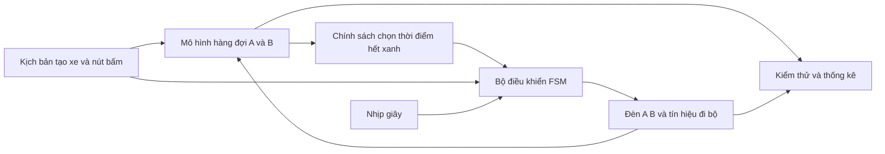

# Thiết kế hệ thống

## Ranh giới của mô hình

Hàng đợi là dữ liệu đầu vào của bộ điều khiển, không phải cảm biến thật. Mô hình xe và testbench nằm ngoài phần điều khiển. `traffic_top` có thể nhận hai số xe ước lượng từ một hệ thống khác; bản này chưa triển khai phần cứng đo xe.

## Quy tắc thời gian

| Tham số | Giá trị mặc định |
|---|---:|
| Xanh cố định | 12 giây |
| Xanh thích ứng tối thiểu | 6 giây |
| Xanh thích ứng tối đa | 20 giây |
| Vàng | 3 giây |
| Đỏ toàn phần | 1 giây |
| Người đi bộ | 6 giây |
| Chờ sau đi bộ | 1 giây |
| Phục vụ xe | 1 xe mỗi 2 giây xanh khi còn xe chờ |

Các tham số bộ điều khiển là số nguyên dương, MIN_GREEN không vượt MAX_GREEN, thời lượng không quá 65535 tick. Chưa kiểm thử mọi cấu hình tham số; bộ test nghiệm thu dùng mặc định. Đây là thông số mô phỏng, không dùng làm thiết kế nút giao ngoài thực tế.

## Quy tắc thích ứng

Sau mỗi tick giây, pha xanh chỉ có thể kết thúc khi:

1. Đã chạy đủ 20 giây; hoặc
2. Đã chạy ít nhất 6 giây và số xe chờ của hướng đối diện lớn hơn hướng đang xanh.

Điều kiện thứ hai bao gồm trường hợp hướng đang xanh hết xe và hướng kia có xe. Khi hai bên bằng nhau, hoặc cả hai trống, giữ xanh đến tối đa nếu đầu vào không thay đổi. Hai hướng luôn luân phiên, không bỏ lượt; thời gian tối đa ngăn một lượt xanh kéo dài vô hạn. Đây là thuật toán đơn giản để nghiên cứu so sánh, chưa phải thuật toán tối ưu giao thông.

## FSM

| Mã | Trạng thái | Đèn A | Đèn B | Kết thúc chuyển sang |
|---:|---|---|---|---|
| 0 | BOOT | Đỏ | Đỏ | A_GREEN sau 1 giây |
| 1 | A_GREEN | Xanh | Đỏ | A_YELLOW theo chính sách |
| 2 | A_YELLOW | Vàng | Đỏ | AFTER_A sau 3 giây |
| 3 | AFTER_A | Đỏ | Đỏ | PED_WALK nếu có yêu cầu; nếu không B_GREEN |
| 4 | B_GREEN | Đỏ | Xanh | B_YELLOW theo chính sách |
| 5 | B_YELLOW | Đỏ | Vàng | AFTER_B sau 3 giây |
| 6 | AFTER_B | Đỏ | Đỏ | PED_WALK nếu có yêu cầu; nếu không A_GREEN |
| 7 | PED_WALK | Đỏ | Đỏ | PED_CLEAR sau 6 giây |
| 8 | PED_CLEAR | Đỏ | Đỏ | Hướng xe kế tiếp sau 1 giây |

AFTER_A và AFTER_B kéo dài 1 giây. Sau đi bộ, không quay lại hướng vừa được phục vụ: đi bộ sau A thì tiếp tục B; sau B thì tiếp tục A. BOOT không phục vụ yêu cầu đi bộ ngay; yêu cầu được lưu đến hết lượt A đầu tiên.

## Người đi bộ và sự kiện đồng thời

- Bắt cạnh lên nút bấm ở mỗi clock, kể cả giữa hai tick giây. Không kéo dài pha xanh vì nút bấm.
- Giữ nút không tạo yêu cầu lặp. Nhiều lần bấm khi đã có yêu cầu được gộp thành một.
- Bấm trong PED_WALK bị bỏ qua và không kéo dài lượt đang phục vụ.
- Bấm trong PED_CLEAR được ghi nhớ để phục vụ ở cuối lượt xe tiếp theo.
- Bấm đúng tick kết thúc AFTER_A/B được phục vụ ngay tại ranh giới đó; không bị mất yêu cầu.
- Reset có ưu tiên cao nhất, đưa hai hướng về đỏ, xóa yêu cầu và đặt elapsed bằng 0.
- `mode_active` lấy `mode_select` trong các clock reset. Thay đổi mode_select ngoài reset không ảnh hưởng vận hành.
- Mô hình hàng đợi cũng reset về 0. So sánh hai chế độ bắt đầu từ cùng hàng đợi rỗng và cùng chuỗi xe đến.

## Giao tiếp và đếm thời gian

`tick` là clock enable, không phải clock thứ hai. FSM cập nhật thời gian ở cạnh lên `clk` khi tick=1. Trong `traffic_top`, bộ chia tạo tick mỗi CYCLES_PER_SECOND clock. Test hệ thống rút gọn một clock thành một giây mô phỏng; thời gian hiển thị trên GTKWave không phải giây thực.

| Tín hiệu | Ý nghĩa |
|---|---|
| queue_a/b, 8 bit | Số xe chờ 0–255 trước tick hiện tại |
| mode_select / mode_active | Chế độ yêu cầu / đang chạy; 0 cố định, 1 thích ứng |
| ped_button / ped_pending | Nút yêu cầu / yêu cầu đã lưu |
| lights_a/b, 3 bit | `{đỏ,vàng,xanh}`: 4 đỏ, 2 vàng, 1 xanh |
| walk | Cho người đi bộ trong mô hình qua đường khi bằng 1 |
| elapsed | Số giây đầy đủ đã trôi trong pha, bắt đầu từ 0 |
| remaining | Số giây còn lại; ở xanh thích ứng là giới hạn trên, có thể kết thúc sớm |

Tại tick chuyển pha, bộ điều khiển xét hàng đợi **trước** cập nhật xe đến/đi của tick đó. Mô hình xe phục vụ theo màu đèn trước cạnh clock, rồi mới xuất số xe mới. Vì thế xe vừa đến khi hàng đợi đang rỗng không đi ngay trong cùng tick.

Hàng đợi tăng theo arrivals 0–15 xe/tick và giảm theo departed. Khi đạt quá 255, giữ ở 255 và báo overflow; các kịch bản đánh giá không được tràn. Bộ đếm phục vụ được khởi động lại khi không xanh hoặc hàng đợi rỗng; không tích lũy khả năng phục vụ trong pha đỏ.

Nút giữ qua reset: mức cao sau nhả reset được xem là yêu cầu mới do button_prev được xóa khi reset. Nhóm cần giữ lựa chọn này khi sửa giao tiếp.
